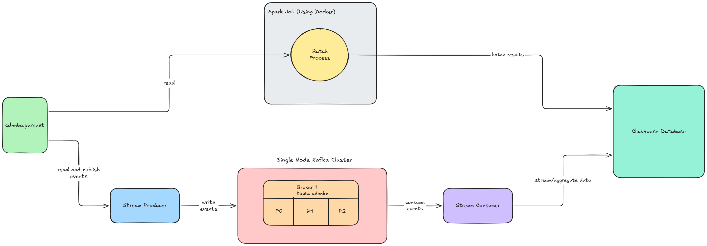

# Statline

An NBA play-by-play data pipeline

## Architecture



## Running locally

Install [GNU Make](https://www.gnu.org/software/make/), [`uv`](https://docs.astral.sh/uv/), and [Docker](https://www.docker.com/get-started/).

Linux-based operating systems are HIGHLY recommended for ease of development and native GNU Make support.

If you're using Windows, we recommend WSL2 with Docker Desktop for a Linux-like development environment. 
Alternatively, if you prefer working directly in Windows, you can install GNU Make using a package manager such as Chocolatey or Scoop:

```sh
# install using chocolately
> choco install make

# or scoop
> scoop install make
```
This does however require you to first install [Chocolately](https://chocolatey.org/install) or [Scoop](https://scoop.sh/).

### Run everything

Place the dataset at `data/cdnnba.parquet` first:

```sh
curl --fail -L -o data/cdnnba.parquet https://huggingface.co/datasets/Vladislav/nba_dataset/resolve/main/cdnnba.parquet
```

This one command performs the project setup and validation, starts the Docker services, and runs the entire pipeline:

```sh
make run
```

### Run each part separately

```sh
# Install dependencies, formatting, lint checks, and validation
make check

# Start Spark, ClickHouse, and Kafka services
make docker-run

# Run each pipeline entrypoint individually
make prepare-data
make run-batch
make run-serve
make run-producer
make run-consumer

# Query already-loaded batch results or inspect persisted stream counts
make query-serve
make stream-results

# Run the entire batch and streaming pipeline after Docker is running
make run-pipeline
```

### Test data-quality rules

The smoke test uses generated rows, so it does not require the NBA dataset:

```sh
make docker-run
make test-quality
```

With `data/cdnnba.parquet` available, validate the real dataset or append five
labelled bad rows to prove that each rule catches its expected failure:

```sh
make run-quality
make run-quality-injected
```

Results are written to `data/quality/quality_report.json` and
`data/quality/quarantine.parquet`.

The five checks cover missing game IDs, invalid action numbers, invalid event
timestamps, invalid periods, and invalid shot results. `make run-quality-injected`
adds one labelled failure for each rule; it is expected to quarantine all five
injected rows without flagging source rows. Quality validation currently runs in
Spark before later stages; the synthetic bad rows are not sent to Kafka or
ClickHouse.

## Serving and streaming results

`make run-serve` loads the batch player/game aggregates into ClickHouse. Loads
are validated and replace the previous snapshot, so rerunning the loader does
not duplicate player/game rows. The serving table is partitioned by season and
ordered by player, season, and game; it retains zero-make games so the three
shooting questions use the correct denominators.

`make query-serve` runs each supplied SQL query three times and writes answers,
individual timings, means, and ClickHouse version details to
`data/serve_measurements.json`. `response_ms` includes local client and Docker
startup overhead; `server_ms` is ClickHouse execution time. These are warm-cache,
local measurements and will vary by environment.

The Kafka consumer persists running counts by game and period to ClickHouse
every 10,000 events and when replay finishes. Use `make stream-results` to view
the latest counts. Those records are replacement snapshots, not increments:
queries use ClickHouse `FINAL`, and each consumer invocation has its own replay
ID. A restarted consumer therefore creates a separate, potentially partial
observation from its committed Kafka offsets.

For direct database access:

```sh
docker compose exec clickhouse clickhouse-client --database statline
```

The pipeline prepares Parquet partitioned by season (`YEAR`), runs Spark, loads
its player/game results into ClickHouse, answers all three questions with timings,
then publishes and consumes the Kafka replay. The consumer saves its running
game/period counts in the same ClickHouse database every 10,000 events and at the end.
